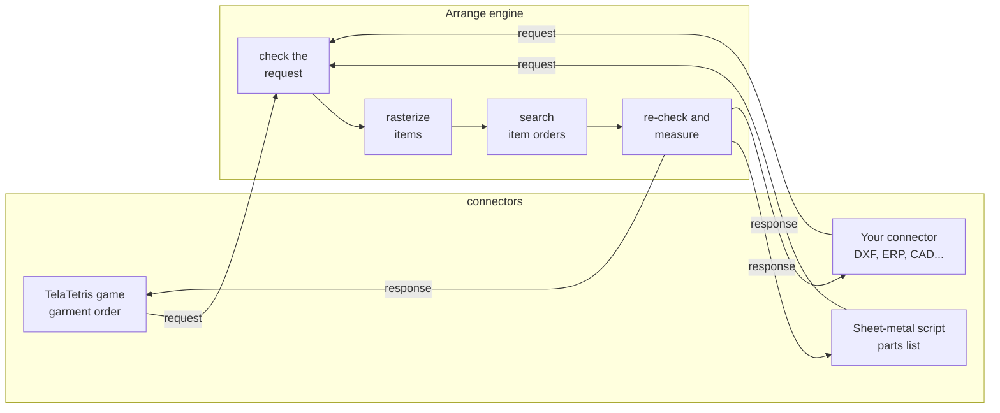

# Arrange

Arrange lays out irregular shapes on a strip of fixed width, using as little length as it can. A fabric roll, a steel coil, a glass sheet and a roll of vinyl are the same problem once you know four things: how wide the strip is, how far apart the parts must stay, which rotations each part allows, and where the strip has defects.

The engine is one dependency-free JavaScript file. Everything around it is a **connector**: a small program that turns one domain's input into a request, and the engine's response back into that domain's output. TelaTetris, the fabric game, is one connector. The sheet-metal script is another.



## How the engine works

A request goes through four steps. Each one is a few dozen lines in [`arrange/arrange.js`](arrange/arrange.js).

**1. Check the request.** The engine validates the request against the [protocol](arrange/PROTOCOL.md) and lists every problem it finds (`status: "invalid"`), so a connector can show them all at once.

**2. Rasterize.** The engine converts everything to a grid of square cells, `cellSize` units wide. Each item becomes a **body**, meaning every cell its outline touches, one per allowed rotation. Then the body grows by `gap` cells into a **template**. Here is an L bracket with arms 1.5 and 2.5 cells thick, on a 1-cell gap:

```
░░░░░░░░░░░      █  body: cells the outline touches (1.5 rounds up to 2)
░█████████░      ░  template: the body grown by the gap
░█████████░      ·  free
░███░░░░░░░
░███░······
░███░······
░░░░░······
```

A placement is legal when the template stays on the strip and doesn't touch any other body or blocked cell. That single rule keeps parts apart, away from the edges and off the defects. The same check runs everywhere: in the search, in the shelf baseline, in live play in the game, and in the final validation.

**3. Search.** A greedy pass places the items one at a time, each in the free spot whose shape fits it best. A search over item orders runs that pass again and again and keeps the shortest layout. [The arrange algorithm](#the-arrange-algorithm) below explains both.

**4. Re-check and measure.** The engine validates the best layout from scratch, on a fresh grid, and reports length, utilization, the shelf baseline and every placement. Placements come back in the connector's units, with the placed outline and the transform to apply to the original.

## The arrange algorithm

The placement method comes from Meng et al., "Optimizing 2D irregular packing via image processing and computational intelligence" ([citation](#citation)). Their idea is to treat packing as image matching. The strip and every part are black-and-white images. Finding a spot for a part then becomes a classic image-processing question: where does this small picture best match the larger one? Normalized cross-correlation (NCC) answers it.

One pass, as in the paper:

1. **Grow each part by the gap** (the paper's Eq. 1). The grown image is the part's template.
2. **Sort the parts**, largest first, by bounding-box width plus height (Eq. 2).
3. **Place each part in turn:**
   - invert the strip image, so free cells are 1 and occupied cells are 0;
   - fill free pockets with fewer cells than the template, since the part can never use them;
   - try every allowed rotation at every position inside a window near the left end of the layout, and drop the positions where the template would cover an occupied cell (Eq. 9);
   - score the remaining positions with NCC (Eq. 6) and take the highest. If nothing fits, widen the window and try again (Eqs. 8 to 13).

For black-and-white images, at a position where the part fits, the NCC score has a plain meaning:

```
score = (nT − t̄·A) / √((A − A²/n) · (nT − nT²/n)),   t̄ = nT / n
```

Here `n` counts the cells in the template's box plus a one-cell margin, `nT` the template's cells, and `A` the free cells in that box. The score is 1 when the free cells in the box are exactly the part's shape, so the part plugs a hole cut for it. It drops toward 0 as the part sits in more open space. A high score means the part leaves no slivers around it, which is what keeps waste down.

The window keeps the layout growing from left to right. Without it, the best match could land anywhere on the strip and leave gaps behind.

What Arrange adds to the paper:

- **A search over item orders.** The paper runs one pass, largest first. Arrange then swaps or moves one item in the order, runs the pass again, and keeps the new order whenever the layout is no longer. This is where most of the gain comes from. On the demo's 4-shirt order the paper's single pass needs 333 cm of roll, and 3.5 s of search brings it to 285 cm. Laid out by shelves, the way people often do it by hand, the order needs 360 cm.
- **Integral images instead of FFT convolution.** The scores are the same, but each position costs a handful of additions, so a pass over 24 garment pieces takes about 35 ms.
- **Per-item rotations and blocked regions.** Each item lists its own allowed rotations (0° and 180° for fabric with a grain line) instead of always trying all four. The strip can have defects no part may cover.
- **A gap that holds on diagonals.** The paper grows parts with a disk. For gaps of 2+ cells that lets corners get closer than the gap, so Arrange grows by edge distance instead. For a 1-cell gap the two are identical.
- **An independent check.** The engine re-validates every layout from scratch before reporting it.

[`reference/ncc_packing.py`](reference/ncc_packing.py) is a plain Python port of the paper's method, with comments pointing to its equations.

## The protocol

Connectors and the engine exchange JSON. A request describes the strip and the items. This one is cut down from the sheet-metal job:

```json
{
  "protocol": "arrange/1",
  "units": "mm",
  "cellSize": 5,
  "strip": { "width": 1000, "gap": 5, "blocked": [[[320, 380], [400, 360], [430, 430], [310, 450]]] },
  "items": [
    { "key": "gusset", "polygon": [[0, 0], [110, 0], [0, 110]], "rotations": [0, 90, 180, 270], "quantity": 8 }
  ],
  "search": { "timeMs": 3000 }
}
```

The response says where everything went. This is the full job's answer, trimmed to one placement:

```json
{
  "protocol": "arrange/1",
  "status": "ok",
  "units": "mm",
  "length": 660,
  "utilization": 0.55,
  "placements": [
    { "item": 0, "key": "gusset", "copy": 0, "rotation": 90, "x": 5, "y": 5,
      "translate": [115, 5], "polygon": [[115, 5], [115, 115], [5, 5]] }
  ],
  "unplaced": [],
  "check": { "inBounds": true, "noOverlap": true, "rotations": true, "complete": true, "ok": true },
  "baseline": { "length": 825, "utilization": 0.439 }
}
```

A request can also ask the engine to `evaluate` a layout made elsewhere, such as a person's or the current CAD output, and score it by the same rules. That's how the game scores the player.

The engine speaks the protocol three ways:

- **command line**: `node arrange/cli.js < request.json`, so a connector can be written in any language;
- **JavaScript, one shot**: `Arrange.run(request)`;
- **JavaScript, incremental**: `Arrange.session(request)`, which searches a little at a time and checks placements live. The game uses this.

The full spec is in [`arrange/PROTOCOL.md`](arrange/PROTOCOL.md), with a JSON Schema in [`arrange/protocol.schema.json`](arrange/protocol.schema.json).

## Connectors

| Connector | Domain | Uses |
|---|---|---|
| [`connectors/telatetris`](connectors/telatetris/README.md) | T-shirt pieces on a 150 cm fabric roll. Rotations 0° and 180° only, to keep the grain line. A browser game: you lay out the order against the clock, then the engine rearranges your pieces. | A session, for live placement checks, step-by-step search, and `evaluate` to score the player. |
| [`connectors/sheet-metal`](connectors/sheet-metal/sheet-metal.js) | 26 steel parts on a 1 m coil, any 90° rotation, a rust spot to avoid. Writes an SVG. | `solve`, or the CLI. |

Writing a new one takes three steps: map your shapes to `items`, describe the material in `strip`, and read `placements` back. [`PROTOCOL.md`](arrange/PROTOCOL.md#writing-a-connector) walks through it.

## Running it

```sh
npm test                                                    # engine, protocol and connector tests (Node 18+)
node connectors/sheet-metal/sheet-metal.js layout.svg       # solve the metal job, write an SVG
node connectors/sheet-metal/sheet-metal.js --request | node arrange/cli.js   # same job through the CLI
node arrange/cli.js arrange/examples/minimal.json           # the smallest complete request
```

Open `connectors/telatetris/index.html` in a browser for the game. It needs no build step and no server.

## Layout

| Path | What it is |
|---|---|
| `arrange/arrange.js` | The engine: core (cells, rasters, search) and protocol layer. Browser (`window.Arrange`) and Node. |
| `arrange/cli.js` | The protocol over stdin/stdout. |
| `arrange/PROTOCOL.md`, `arrange/protocol.schema.json` | The contract connectors code against. |
| [`arrange/README.md`](arrange/README.md) | Engine internals and the core API, for interactive connectors. |
| `connectors/` | One folder per connector. |
| `test/` | Tests for the engine, the protocol (responses are checked against the schema) and the garment connector. |
| [`reference/`](reference/README.md) | The paper's algorithm in Python. |

## Citation

The placement method is from:

> Meng, L., Ding, L., Pu, Y., Wang, X., Mushtaq, R. T., Alkahtani, M. & Shakeel, M. Optimizing 2D irregular packing via image processing and computational intelligence. *Scientific Reports* **15**, 12320 (2025). https://doi.org/10.1038/s41598-025-97202-0

```bibtex
@article{meng2025packing,
  title   = {Optimizing 2D irregular packing via image processing and computational intelligence},
  author  = {Meng, Longhui and Ding, Liang and Pu, Yunkai and Wang, Xiaomeng and
             Mushtaq, Ray Tahir and Alkahtani, Mohammed and Shakeel, Muhammad},
  journal = {Scientific Reports},
  volume  = {15},
  number  = {1},
  pages   = {12320},
  year    = {2025},
  doi     = {10.1038/s41598-025-97202-0}
}
```

Arrange is an independent implementation. The order search, blocked regions, edge-distance gap and the protocol are not from the paper.

## Limits

- One open-ended strip. Fixed-size sheets, where parts spill onto the next sheet, would need a new task in the protocol.
- No mirroring. If a part may flip, send the mirrored outline as a second item.
- A part's cut-outs are filled, so nothing nests inside another part's hole.
- The engine minimizes strip length. Other goals, such as grouping a garment's pieces together, would need a new search objective.
